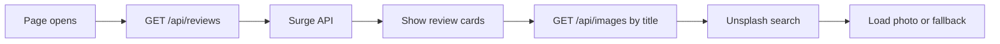
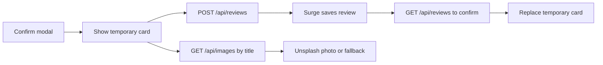
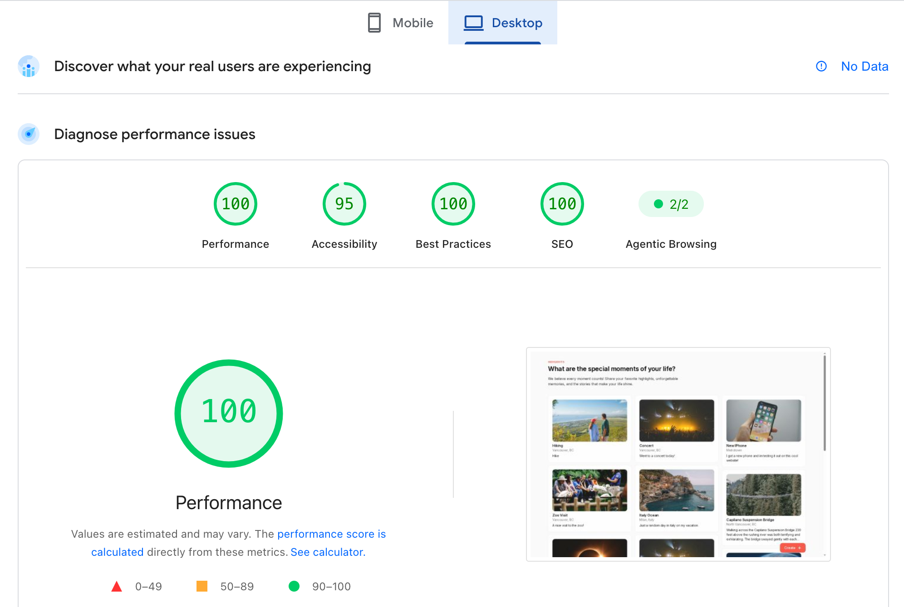
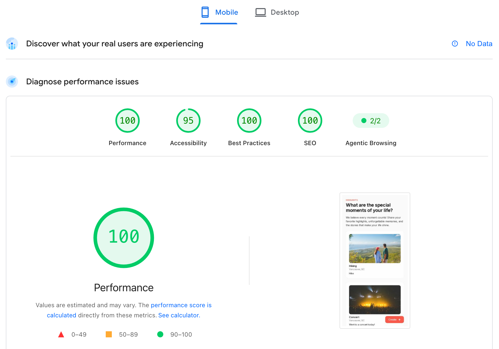

# Highlights | BQ Surge Take-Home

A small highlights app for my SFU Surge take-home, built to match the provided
Figma design. Next.js, TypeScript, Tailwind CSS, and Biome.

[Live demo](https://sfu-surge-take-home.vercel.app)

## What it does

- Live reviews in one, two, or three independent columns.
- Animated card skeletons while reviews load, then separate photo loaders.
- Title-based Unsplash images, with a local fallback when a photo can't load.
- A create modal with required title, location, and description fields.
- New cards appear right away while they save, with a retry option if needed.
- Clipped descriptions show the full text on hover, keyboard focus, or tap.
- Popover fades and modal open/close motion respect reduced-motion settings.

## How it works

### Loading highlights



### Creating a highlight



### Optimistic updates

- Confirm closes the modal and puts a temporary card at the top immediately.
- POST saves the review in the background while its photo loads separately.
- GET finds the saved review and replaces the temporary ID without changing card height.
- If a request fails, the card keeps your text and shows Retry. After a successful
  POST, Retry only repeats GET to confirm the save.

The card keeps the same client key throughout, so confirmation doesn't remount it.
Saves run one at a time, and repeated Retry clicks can't queue the same card twice.
Unsaved cards live in page memory and can be lost on refresh.

## Run locally

```sh
npm install
cp .env.example .env.local
```

Set `SURGE_API_ID` to the identifier Surge gave you and add your
`UNSPLASH_ACCESS_KEY` in `.env.local`.
Only the Unsplash Access Key is needed, not the Secret Key. Both stay on the server.

```sh
npm run dev
```

Checks:

```sh
npm run lint
npm run typecheck
npm run build
```

## Small touches

A few small touches I added along the way:

- Optimistic updates so new cards appear right away.
- Subtle animations with reduced-motion support.
- Full-description popovers and separate card/photo loaders.
- Custom empty-state and photo fallback illustrations, plus a favicon and link preview.

## Lighthouse results

### Desktop



### Mobile


